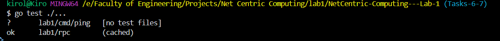
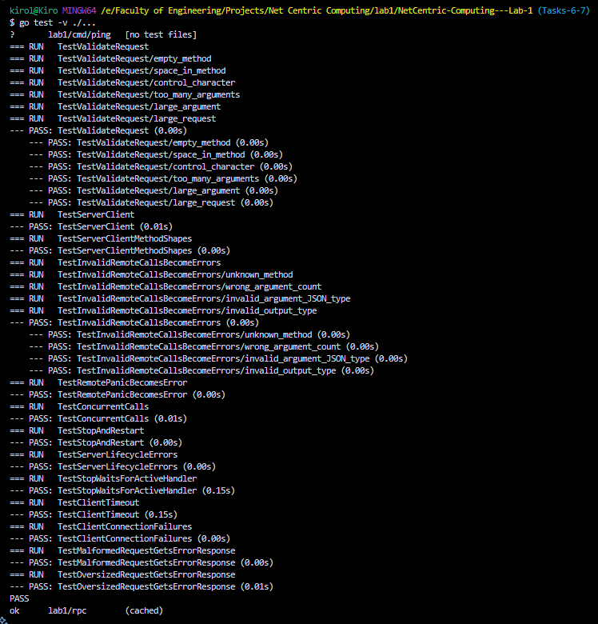
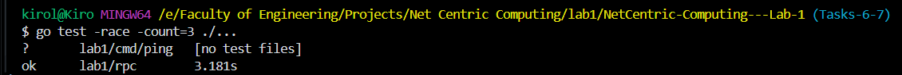
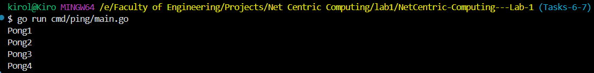

# Lab 1: Reflection-Based RPC System in Go

**Net-Centric Computing | Alexandria University, Faculty of Engineering | Fall 2026**
Computer and Communications Engineering

A small Remote Procedure Call (RPC) system written in Go. A client asks a server to run a method on its behalf over TCP, as if the method were local. Requests and responses are encoded as JSON, and the server uses reflection to find and invoke exported methods at runtime.

---

## Table of Contents

- [Features](#features)
- [Project Structure](#project-structure)
- [Protocol](#protocol)
- [Supported Remote Methods](#supported-remote-methods)
- [Usage Example](#usage-example)
- [Running the Project](#running-the-project)
- [Testing](#testing)
- [Test Results](#test-results)
- [Team](#team)

---

## Features

- TCP server that can start, stop, and restart safely
- Port `0` support, so the operating system picks a free port
- Concurrent handling of client connections
- Request validation (method name, argument count, size limits)
- Reflection-based method invocation with typed JSON arguments
- Remote errors and panics returned as error responses without crashing the server
- Client with timeout, one connection per call, and clear error messages

## Project Structure

```
lab1/
├── go.mod
├── cmd/
│   └── ping/
│       └── main.go        # Demo program: starts a server and calls Ping
└── rpc/
    ├── rpc.go             # Server, Client, validation, and reflection logic
    └── rpc_test.go        # Test suite
```

## Protocol

Each client call uses **one TCP connection** and receives **one response**. The server closes the connection after handling the request.

**Request**

```json
{
  "method": "Add",
  "args": [2, 3]
}
```

**Successful response**

```json
{
  "ok": true,
  "value": 5
}
```

**Error response**

```json
{
  "ok": false,
  "error": "unknown method \"Missing\""
}
```

## Supported Remote Methods

The server can call any exported method on its receiver. Methods may take zero or more typed arguments and may return nothing, one value, one value plus an error, or only an error.

```go
func (s *Service) NoArgs() string
func (s *Service) Add(left, right int) int
func (s *Service) Echo(value string) string
func (s *Service) OnlyError(shouldFail bool) error
func (s *Service) Ping(id int) (string, error)
```

If a method returns a non-nil error, the client receives it as a remote error.

## Usage Example

### Server

```go
package main

import (
	"fmt"
	"log"

	"lab1/rpc"
)

type Service struct{}

func (s *Service) Add(left, right int) int { return left + right }

func main() {
	server, err := rpc.NewServer(&Service{})
	if err != nil {
		log.Fatal(err)
	}
	if err := server.Start("127.0.0.1:0"); err != nil {
		log.Fatal(err)
	}
	defer server.Stop()

	fmt.Println("Listening on", server.Address())
	select {}
}
```

### Client

```go
client, err := rpc.NewClient("127.0.0.1:8080")
if err != nil {
	log.Fatal(err)
}

var sum int
if err := client.Call("Add", &sum, 2, 3); err != nil {
	log.Fatal(err)
}
fmt.Println(sum) // 5
```

Pass `nil` as the output argument when the remote method has no result:

```go
err := client.Call("OnlyError", nil, false)
```

## Running the Project

**Requirements:** Go 1.20 or newer, available in your `PATH`.

```bash
go version
cd lab1
go run ./cmd/ping
```

Expected output:

```
Pong1
Pong2
Pong3
Pong4
```

## Testing

Run all tests from the `lab1` directory:

```bash
cd lab1
go test ./...
```

Verbose output:

```bash
go test -v ./...
```

Run a single test:

```bash
go test -v -run TestClientTimeout ./rpc
```

Check for race conditions:

```bash
go test -race -count=3 ./...
```

The tests cover server lifecycle (start, stop, restart, duplicate start), request validation, all supported method shapes, invalid calls, remote errors and panics, malformed and oversized input, concurrent calls, client timeouts, and an unavailable server.

## Test Results

### All tests passing



### Verbose test output



### Race detector



### Demo program



## Team

| Name | ID |
|------|----|
| Kirolos Morcos | 8622 |
| Omar Mohamed | 8758 |
| Mazen Wael | 9057 |

**Instructors:** Dr. Laurine Armeya, Eng. Adham Khaled